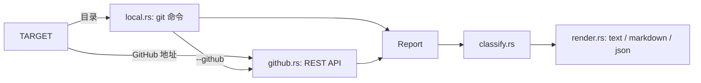

# git-changes 设计文档（v0.2）

> 一句话：给定本地仓库路径或 GitHub 地址，按 Tag / Release 提取完整、可验证的版本事实（提交、破坏性变更、回滚、文件变动、最早引入版本、依赖锁变更），不内置任何 LLM，以稳定的 JSON / 文本输出与 `SKILL.md` 供 AI 工具（Claude Code / Codex / Gemini / agy）或开发者排查版本问题。

## 0. 面向 AI 工具的设计原则

1. **事实与解读分离**：保留原始 `subject` / `body`；分类只是提示，同时输出 `classified_by: conventional | keyword | none`，AI 可自行复核。
2. **数据不完整必须明示**：`--max-commits` 截断、GitHub Compare 250 条上限、GitHub 模式无 cherry-pick 去重等均写入顶层 `warnings[]` 与版本级 `truncated: bool`，绝不静默丢数据。
3. **每个结论附带可验证证据**：输出完整 SHA、PR 编号、结构化 `trailers`（`BREAKING CHANGE`、`Fixes`、`cherry picked from` 等）、回滚配对（`reverts` / `reverted_by`）以及可选的文件变动统计（`--files`），AI 可据此进一步执行 `git show <sha>`。
4. **契约稳定**：JSON 顶层带 `schema_version: 1`；所有命令均支持 `-f json`。

## 1. CLI

```text
git-changes [TARGET] [OPTIONS]
git-changes find <QUERY> [TARGET] [-f text|json]
git-changes which <REV> [TARGET] [-f text|json]
git-changes deps <FROM> <TO> [TARGET] [-f text|json]
git-changes skill [--dir DIR] [--print]

TARGET            本地路径（默认 "."）或 GitHub 地址：
                  https://github.com/o/r[.git] | git@github.com:o/r.git | o/r
-n, --limit N     展示最近 N 个版本（默认 5）
    --tag T       只看某个 Tag
    --range A..B  只看 A 与 B 之间的变更（也可写作 --range A B）
    --unreleased  额外展示最新 Tag 之后、尚未发布的提交
    --path PATH   只看触及指定文件或目录的提交（可多次传入，仅本地仓库）
    --grep TEXT   只看标题、正文或 SHA/PR 匹配关键词的提交（不区分大小写）
    --files       附带每个提交修改的文件与增删行数（仅本地仓库）
    --github      本地模式下，按 origin 拉取 GitHub Release Notes 合并展示
    --token TOK   GitHub Token（默认读取环境变量 GITHUB_TOKEN）
    --max-commits 每个版本最多展示的提交数（默认 200）
    --merges      保留合并提交（默认过滤）
    --oldest-first 按升级顺序从旧到新排列版本
-f, --format      text | brief | markdown | json（默认 text）
-o, --output F    写入文件
    --lang        zh | en（默认 zh）
```

判定：`TARGET` 是已存在的目录 → 本地模式；否则按 GitHub 地址解析，解析失败报错。

### 排查子命令（本地仓库）

- **`git-changes find <QUERY> [TARGET]`**：定位某个提交（SHA 前缀、完整 SHA、`#123` PR 号或标题/正文关键词）进入项目的脉络：
  - 匹配到的原始提交（SHA、日期、作者、标题、PR）；
  - 通过 `git tag --contains <sha>` 找到包含该提交的所有 Tag，按前缀分组并取每组最早版本（`first_tag`）及完整 Tag 列表；
  - 扫描其他分支/Tag 上的 cherry-pick 副本（匹配 `(cherry picked from commit <sha>)` 或相同标题/patch-id），列出回移提交及其最早 Tag（回答「有没有 backport 到 hotfix 版本」）。
- **`git-changes which <REV> [TARGET]`**：给定线上运行的 commit / ref，回答它所处的位置：
  - 解析后的完整 SHA、提交日期与标题；
  - 精确命中的 Tag（若有）；
  - 祖先方向最近的 Tag（`base_tag`）及距离提交数（`ahead`），来自 `git describe --tags --long`；
  - 后继方向最早包含它的 Tag（`next_tag`，按各前缀组最早版本），若尚未发版则为 `null`（unreleased）。
- **`git-changes deps <FROM> <TO> [TARGET]`**：对比两个版本之间的依赖锁文件变更，自动检测仓库中的 `Cargo.lock`、`uv.lock`、`package-lock.json`、`go.sum`，分类输出 `added`、`removed`、`updated`（含旧版本列表 → 新版本列表）。

## 2. 数据流



模块只通过 `model.rs` 中的纯数据连接，没有 trait：本地与 GitHub 两个数据源的取数方式差异太大，强行统一接口只会产生转发层。

## 3. 关键决策

| 问题 | v0.1 方案 | 重估条件 |
| --- | --- | --- |
| 读本地仓库 | 调用系统 `git`，用 `\x1f`/`\x1e` 分隔字段解析 | 需在无 git 环境运行，或扫描耗时 > 500ms |
| 本地「上一个 Tag」 | `git describe --tags --abbrev=0 <tag>^`（拓扑上最近的可达 Tag，天然适配多发布线） | — |
| 本地版本顺序 | `for-each-ref --sort=-creatordate` | — |
| GitHub Tag 列表 | `git ls-remote --tags <url>`：一次拿到全部 Tag，不占 API 配额（Tags API 每页 100 且需翻页） | 私有仓库 ls-remote 无凭据失败的真实案例 → 回退 Tags API |
| GitHub 版本顺序 / 上一个 Tag | ls-remote 无日期，按版本号排序：拆为 `前缀 + 数字段 + 后缀`，同前缀内取下一个更小的版本；多前缀（monorepo）时 Tag 数最多的前缀组排在前 | 出现排序错乱的真实案例；monorepo 可用 `--tag` / `--range` 精确指定 |
| GitHub 区间提交 | `compare/{prev}...{tag}`，单次最多 250 条；超出时标注「显示 N / 共 M」 | 经常需要全量 → 增加 `--clone` 模式 |
| GitHub 首个版本 | 不拉提交明细（省请求），只展示 Release 说明 | — |
| `--range A B` 分段 | 至少一端是 Tag 时，按版本号取中间同前缀的 Tag 切开（含 hotfix 分支 Tag，符合「升级路径」的直觉）；非 Tag 端点退回按祖先关系筛选。每段用 `A...B --cherry-pick --right-only`，去掉已在上一版本回合过的提交；线性历史下等价于 `A..B` | 版本号排序与发布顺序不一致的真实案例 |
| 限流 | 匿名 60 次/小时；默认 limit 5 约 6 次请求（1 次 Releases + 5 次 Compare）；限流时给出明确提示 | — |
| 分类 | ① Conventional Commits；② 首词/关键词启发式（中英文）；③ 其他 | 真实仓库「其他」占比持续 > 50% → 评估可选 LLM 摘要 |

## 4. 分类规则

1. `type(scope)!: msg` 解析：
   - `feat/feature` → 新增功能；`fix/bugfix/hotfix` → 问题修复；`perf` → 性能优化；
     `refactor` → 重构；`docs/doc` → 文档；`test/build/ci/chore/style/deps/revert/release` → 维护；
   - 未知 type（如 Go 风格 `net/http: fix ...`）视为 scope，对 msg 走启发式。
2. 破坏性变更：`!` 或正文含 `BREAKING CHANGE:` / `BREAKING-CHANGE:`，作为独立标记，分组时优先展示。
3. 启发式：先看首词（`add/support/implement…`、`fix/resolve…`、`新增/支持/修复/解决…`），再看包含词（`bug/crash/panic/修复`）。
4. 提取标题末尾的 `(#123)` 作为 PR 编号。

## 5. 边界情况

- 无任何 Tag：展示 `HEAD` 全部提交（受 `--max-commits` 限制），标记为「未发布」。
- 首个 Tag：本地模式展示该 Tag 之前的历史（受 `--max-commits` 限制）。
- 合并提交默认过滤，信息由被合并的实际提交承载。
- 轻量 Tag 无附注信息；附注 Tag 的 message 作为「Tag 说明」展示。

## 6. JSON 事实契约与回滚 / Trailer 解析

- `Report` 顶层包含 `schema_version: 1`、`warnings: Vec<String>`。
- `Version` 包含 `truncated: bool`（当 `total_commits > commits.len()` 时为 `true`，同时写入顶层 `warnings`）。
- `Commit` 除分类结果外，保留：
  - `body`: 原始正文（空串在 JSON 中省略以保持紧凑，或存在时完整输出）；
  - `classified_by`: `"conventional" | "keyword" | "none"`，标明分类依据；
  - `trailers`: 从正文提取的关键元数据（`BREAKING CHANGE`、`Fixes/Closes/Resolves`、`Refs`、`Co-authored-by`、`cherry picked from commit <sha>`）；
  - `reverts` / `reverted_by`: 识别 `Revert "<subject>"` 或正文 `This reverts commit <sha>`，若同版本区间内存在被回滚的原提交，则双向关联 SHA，避免 AI 将已回滚的变更误判为有效变更；
  - `files`: 当开启 `--files` 时，通过单次 `git log --numstat` 批量采集每个提交的改动文件列表与增删行数（不逐个 commit 调 `git show`，保持 O(1) 进程调用）。
