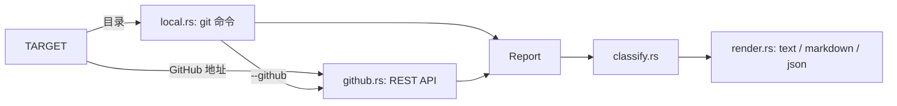

# taglens 设计文档（v0.1）

> 一句话：给定本地仓库路径或 GitHub 地址，按 Tag / Release 列出每个版本相对上一版本的提交，并把提交归类为「新增功能 / 问题修复 / 破坏性变更 …」。

## 1. CLI

```text
taglens [TARGET] [OPTIONS]

TARGET            本地路径（默认 "."）或 GitHub 地址：
                  https://github.com/o/r[.git] | git@github.com:o/r.git | o/r
-n, --limit N     展示最近 N 个版本（默认 5）
    --tag T       只看某个 Tag
    --range A..B  只看 A 与 B 之间的变更
    --unreleased  额外展示最新 Tag 之后、尚未发布的提交
    --github      本地模式下，按 origin 拉取 GitHub Release Notes 合并展示
    --token TOK   GitHub Token（默认读取环境变量 GITHUB_TOKEN）
    --max-commits 每个版本最多展示的提交数（默认 200）
    --merges      保留合并提交（默认过滤）
-f, --format      text | markdown | json（默认 text）
-o, --output F    写入文件
    --lang        zh | en（默认 zh）
```

判定：`TARGET` 是已存在的目录 → 本地模式；否则按 GitHub 地址解析，解析失败报错。

## 2. 数据流



模块只通过 `model.rs` 中的纯数据连接，没有 trait：本地与 GitHub 两个数据源的取数方式差异太大，强行统一接口只会产生转发层。

## 3. 关键决策

| 问题 | v0.1 方案 | 重估条件 |
| --- | --- | --- |
| 读本地仓库 | 调用系统 `git`，用 `\x1f`/`\x1e` 分隔字段解析 | 需在无 git 环境运行，或扫描耗时 > 500ms |
| 本地「上一个 Tag」 | `git describe --tags --abbrev=0 <tag>^`（拓扑上最近的可达 Tag，天然适配多发布线） | — |
| 本地版本顺序 | `for-each-ref --sort=-creatordate` | — |
| GitHub Tag 列表 | `git ls-remote --tags <url>`：一次拿到全部 Tag，不占 API 配额（Tags API 每页 100 且需翻页） | 私有仓库 ls-remote 无凭据失败的真实案例 → 回退 Tags API |
| GitHub 版本顺序 / 上一个 Tag | ls-remote 无日期，按版本号排序：拆为 `前缀 + 数字段 + 后缀`，同前缀内取下一个更小的版本；多前缀（monorepo）时 Tag 数最多的前缀组排在前 | 出现排序错乱的真实案例；monorepo 可用 `--tag` / `--range` 精确指定 |
| GitHub 区间提交 | `compare/{prev}...{tag}`，单次最多 250 条；超出时标注「显示 N / 共 M」 | 经常需要全量 → 增加 `--clone` 模式 |
| GitHub 首个版本 | 不拉提交明细（省请求），只展示 Release 说明 | — |
| 限流 | 匿名 60 次/小时；默认 limit 5 约 6 次请求（1 次 Releases + 5 次 Compare）；限流时给出明确提示 | — |
| 分类 | ① Conventional Commits；② 首词/关键词启发式（中英文）；③ 其他 | 真实仓库「其他」占比持续 > 50% → 评估可选 LLM 摘要 |

## 4. 分类规则

1. `type(scope)!: msg` 解析：
   - `feat/feature` → 新增功能；`fix/bugfix/hotfix` → 问题修复；`perf` → 性能优化；
     `refactor` → 重构；`docs/doc` → 文档；`test/build/ci/chore/style/deps/revert/release` → 维护；
   - 未知 type（如 Go 风格 `net/http: fix ...`）视为 scope，对 msg 走启发式。
2. 破坏性变更：`!` 或正文含 `BREAKING CHANGE:` / `BREAKING-CHANGE:`，作为独立标记，分组时优先展示。
3. 启发式：先看首词（`add/support/implement…`、`fix/resolve…`、`新增/支持/修复/解决…`），再看包含词（`bug/crash/panic/修复`）。
4. 提取标题末尾的 `(#123)` 作为 PR 编号。

## 5. 边界情况

- 无任何 Tag：展示 `HEAD` 全部提交（受 `--max-commits` 限制），标记为「未发布」。
- 首个 Tag：本地模式展示该 Tag 之前的历史（受 `--max-commits` 限制）。
- 合并提交默认过滤，信息由被合并的实际提交承载。
- 轻量 Tag 无附注信息；附注 Tag 的 message 作为「Tag 说明」展示。
